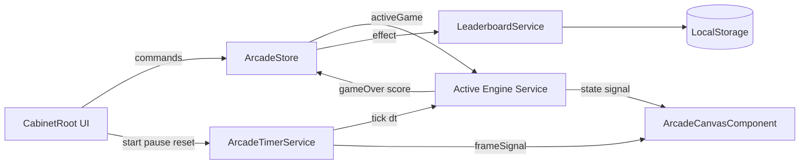

# 02 — Architecture (Angular 22+)

Создай приложение строго по этой архитектуре. Не сваливай игровую математику в компоненты. Не используй NgRx/Akita — только Signals stores и engine services.

---

## 2.1 Стек и bootstrap

1. Создай проект Angular **latest stable ≥ 22**, standalone, SCSS, **без SSR**, без routing (предпочтительно **без** `@angular/router`).
2. Включи **zoneless** (дефолт новых приложений). Не добавляй `zone.js` обратно.
3. Prefix: `rae`.
4. Точка входа: `main.ts` → `bootstrapApplication(AppComponent, appConfig)`.
5. `app.config.ts`: `provideZonelessChangeDetection()` (или эквивалент актуального API).
6. Если используешь Tailwind — добавь официальную интеграцию для Angular/PostCSS полностью. Если SCSS — глобальные CSS variables из документа 01.

---

## 2.2 Дерево каталогов (обязательное)

Минимальный каркас из брифа **обязан** существовать. Доменный слой расширяет его:

```
src/
  index.html
  main.ts
  styles.scss
  app/
    app.component.ts
    app.component.html
    app.component.scss
    app.config.ts

    models/
      arcade.types.ts              # GameId, TetrisState, SnakeState, BreakoutState, LeaderboardEntry

    core/
      constants/
        arcade.constants.ts        # phases, leaderboard limits
        tetris.constants.ts        # shapes, colors, grid size
        snake.constants.ts         # grid cols/rows, speeds
        breakout.constants.ts      # field, brick grid, ball/paddle
        difficulty.constants.ts    # easy/normal/hard intervals
        ui.constants.ts            # layout numbers, CRT
      models/
        game-id.model.ts
        arcade-phase.model.ts
        difficulty-id.model.ts
        direction.model.ts
        tetromino-type.model.ts

    domain/
      tetris/
        tetromino-shapes.ts        # 7 shapes × 4 rotations matrices
        tetris.collision.ts
        tetris.lines.ts
        tetris.scoring.ts
      snake/
        snake.movement.ts
        snake.collision.ts
        snake.apple.ts
      breakout/
        breakout.physics.ts
        breakout.collision.ts
        breakout.bricks.ts
      math/
        clamp.ts
        rng.ts
        aabb.ts

    state/
      arcade.store.ts              # activeGame, phase, difficulty, session, telemetry
      ui.store.ts                  # theme, locale, helpOpen, overlays

    services/
      arcade-timer.service.ts      # rAF game loop
      tetris-engine.service.ts
      snake-engine.service.ts
      breakout-engine.service.ts
      leaderboard.service.ts       # LocalStorage read/write
      hotkeys.service.ts
      i18n.service.ts

    directives/
      keyboard-capture.directive.ts

    components/
      cabinet-root/
        cabinet-root.component.ts
        cabinet-root.component.html
        cabinet-root.component.scss
      arcade-canvas/
        arcade-canvas.component.ts
        arcade-canvas.component.html
        arcade-canvas.component.scss
        arcade-renderer.ts           # imperative draw helpers
      game-selector/
        game-selector.component.ts
        game-selector.component.html
        game-selector.component.scss
      telemetry-panel/
        telemetry-panel.component.ts
        telemetry-panel.component.html
        telemetry-panel.component.scss
      leaderboard/
        leaderboard.component.ts
        leaderboard.component.html
        leaderboard.component.scss
      game-controls/
        game-controls.component.ts
        game-controls.component.html
        game-controls.component.scss
      pause-overlay/
        pause-overlay.component.ts
        pause-overlay.component.html
        pause-overlay.component.scss
      game-over-overlay/
        game-over-overlay.component.ts
        game-over-overlay.component.html
        game-over-overlay.component.scss
      toolbar/
        toolbar.component.ts
        toolbar.component.html
        toolbar.component.scss
      help-overlay/
        help-overlay.component.ts
        help-overlay.component.html
        help-overlay.component.scss
      status-bar/
        status-bar.component.ts
        status-bar.component.html
        status-bar.component.scss

    i18n/
      locale.type.ts
      i18n.keys.ts
      ru.ts
      en.ts
```

---

## 2.3 Поток данных (Signals)



### Правила
1. **Single writer:** только engine service мутирует игровое поле через `state.update(...)`.
2. **Canvas read-only:** компонент читает `engine.state()` и рисует; не двигает змейку.
3. **ArcadeStore** хранит: `activeGameId`, `phase`, `difficultyId`, `sessionStartedAt`, `sessionElapsedMs`, `sessionHighScore` (per current game session).
4. **Timer** не знает правил Tetris — только вызывает `activeEngine.tick(delta)`.
5. **LeaderboardService** — единственная точка записи в LocalStorage; `effect` в store или service синхронизирует при save.

---

## 2.4 ArcadeTimerService — контракт (summary)

Полная спецификация: [04-arcade-timer.md](04-arcade-timer.md).

```ts
@Injectable({ providedIn: 'root' })
export class ArcadeTimerService {
  readonly frameId = signal(0);           // increments every rAF — triggers canvas repaint
  readonly isRunning = signal(false);
  start(onTick: (deltaMs: number) => void): void;
  pause(): void;
  stop(): void;
}
```

- `onTick` вызывается когда `accumulatedMs >= tickIntervalMs` из difficulty + game.
- При `pause()` — cancel rAF, preserve state.
- `DestroyRef` cleanup on service destroy.

---

## 2.5 Engine services — общий контракт

Каждый engine implements единый паттерн:

```ts
export interface GameEngine {
  readonly state: Signal<...>;
  readonly score: Signal<number>;
  readonly level: Signal<number>;
  readonly isGameOver: Signal<boolean>;
  readonly isWin: Signal<boolean>;       // Breakout only; others always false
  init(): void;
  reset(): void;
  tick(deltaMs: number): void;
  handleInput(action: GameInputAction): void;
  getTickIntervalMs(difficulty: DifficultyId): number;
}
```

`CabinetRootComponent` (или facade in `ArcadeStore`) резолвит engine по `activeGameId`:

```ts
readonly activeEngine = computed(() => {
  switch (this.activeGameId()) {
    case 'tetris': return this.tetrisEngine;
    case 'snake': return this.snakeEngine;
    case 'breakout': return this.breakoutEngine;
  }
});
```

---

## 2.6 Keyboard capture

Директива `raeKeyboardCapture` на `cabinet-root` (или canvas host):

- `@HostListener('window:keydown')` / keyup для soft drop hold state.
- `preventDefault()` для: Arrow keys, Space (when not in form focus).
- Emit `output()` events или call `HotkeysService` / engine `handleInput`.

Не дублируй listener в каждом engine.

---

## 2.7 Запрещено

| Запрещено | Причина |
|-----------|---------|
| NgRx, Akita, ComponentStore | Только Signals |
| Phaser, Pixi | Canvas 2D native |
| `setInterval` для game loop | Только rAF + accumulator |
| Zone.js reliance | Zoneless app |
| Routing per game | Single cabinet screen |
| Game logic in `arcade-canvas.component.ts` | Renderer only |

---

## 2.8 App shell

`AppComponent` — thin wrapper:

```html
<rae-cabinet-root />
```

`CabinetRootComponent` — composes toolbar, 3-column layout, overlays, wires stores/services.

---

## 2.9 Performance

- Canvas: не аллоцировать новые массивы 60×60 каждый кадр; reuse buffers where needed.
- Leaderboard sort — только при save/load, не каждый frame.
- Telemetry session timer: update signal каждые 250ms (не каждый rAF), через timer service or `setInterval` **только для UI clock** (не для game logic — game logic stays in rAF ticks).

---

## 2.10 Testing layout

```
src/app/domain/tetris/tetris.lines.spec.ts
src/app/domain/snake/snake.collision.spec.ts
src/app/domain/breakout/breakout.physics.spec.ts
src/app/services/tetris-engine.service.spec.ts
```

Domain pure functions — unit test без TestBed где возможно.
